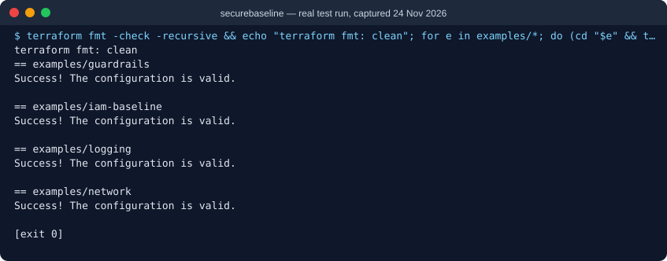

# SecureBaseline — tested Terraform module library — manual

*One page, eight blocks. Every figure here comes from this repository's own tests and README.*

## 1. Claim
Four secure-by-default AWS modules (network, IAM baseline, logging, guardrails) pass validate, tflint, trivy and checkov in CI. Terratest asserts their behaviour after a real apply.

## 2. What it is
Reusable Terraform building blocks that make a new AWS environment safe by default: flow logs on, default security group shut, CloudTrail validated, public buckets flagged.

## 3. Demo
Capture to record: the static gates passing, and one Terratest run against a sandbox account.


*Real `terraform fmt` and `terraform validate` output for every example, captured 24 Nov 2026. Terratest applies into a sandbox account and is not shown.*

## 4. Run it yourself
**Prerequisites:** Terraform, tflint, trivy, checkov, Go (Terratest). A sandbox AWS account for Terratest.

```bash
terraform fmt -check -recursive
terraform validate
tflint && trivy config . && checkov -d .
cd test && go test -timeout 30m
```

## 5. What you will see
All static gates pass. Terratest applies each example, asserts the security property (for example, the default SG has zero rules; a deliberately public bucket is NON_COMPLIANT) and destroys it.

## 6. 30-second talking point
> Safety you have to remember to opt into gets forgotten. These modules make it the default and are tested like code, with four scanners plus behaviour tests against a real apply.

## 7. Scope and limits
- A module library, not a platform. An organisation composes the modules into its own topology.

## 8. Links
[Repository](https://github.com/fhionnghaile/securebaseline) · [Write-up](https://padraigfhionnghaile.com/work/securebaseline/) · [README](README.md)
